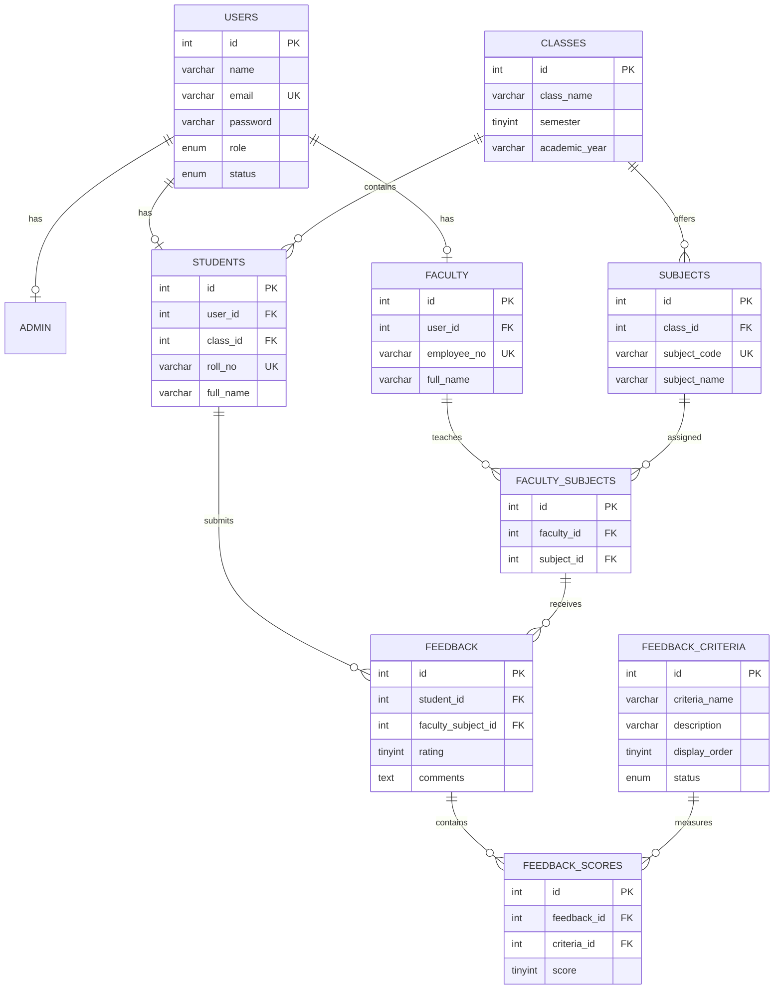
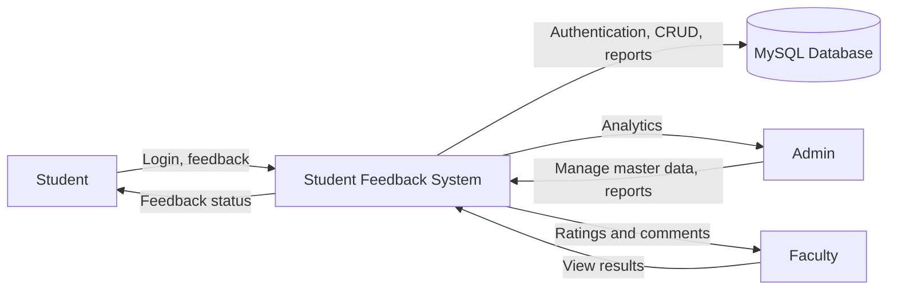
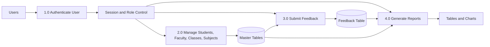
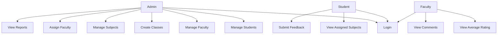
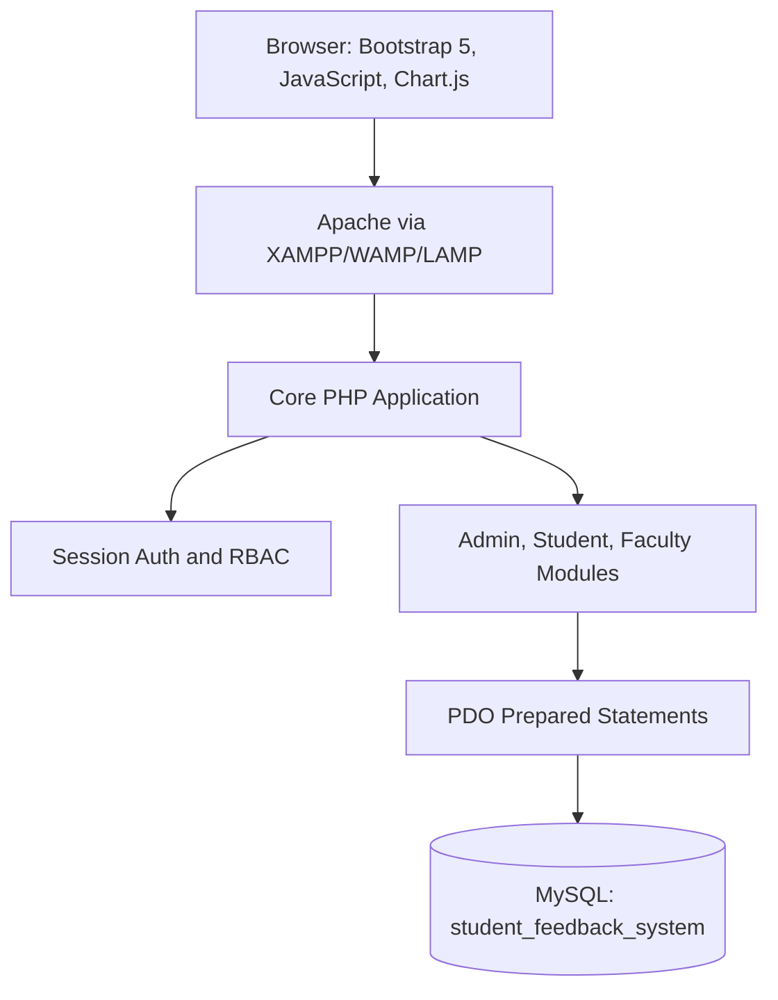

# Student Feedback System Diagrams

These Mermaid diagrams can be pasted into Mermaid Live Editor, GitHub Markdown, or documentation tools that support Mermaid.

## ER Diagram

## DFD Level 0

## DFD Level 1

## Use Case Diagram

## System Architecture Diagram

